# Clase 22: programación modular y paquetes en Python

Prácticas de las sesiones 1 y 2. Álvaro García-Quismondo Lizana · 22 de noviembre de 2026

Esta práctica recoge la ejecución de los ejemplos de las dos sesiones de la clase 22: programación modular (módulos, importaciones, __name__, sys.path) y paquetes (__init__.py, imports relativos, biblioteca estándar y un pipeline ETL). Cada apartado indica el comando, la captura de la salida y lo que se observa.

## 1. Entorno y preparación

Todo se ha ejecutado en Windows, con PowerShell dentro de la terminal integrada de VS Code y Python 3.14. Los ejemplos solo usan la biblioteca estándar, así que no ha hecho falta entorno virtual ni instalar paquetes.

Los 65 archivos de los ejemplos se generan con un único script, crear_clase22.py, que crea cada carpeta ejemplo_* con su contenido. Se ejecuta una sola vez desde la carpeta de la práctica:

```powershell
New-Item -ItemType Directory -Force "C:\Users\Usuario\Documents\clase_22_programacion_modular"
cd "C:\Users\Usuario\Documents\clase_22_programacion_modular"
python crear_clase22.py
```

El explorador de VS Code muestra las 18 carpetas de ejemplos (Figura 1). Cada ejemplo se ejecuta desde su propia carpeta, porque Python busca los módulos empezando por la carpeta del script.

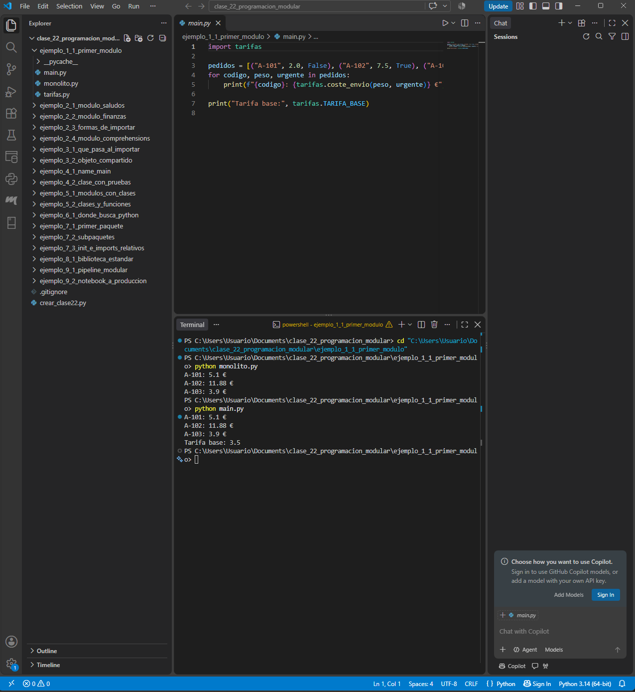

*Figura 1. Carpeta de la práctica abierta en VS Code.*

## 2. Sesión 1: módulos

### Ejemplo 1.1 · Del script único al primer módulo

```
ejemplo_1_1_primer_modulo/
├── monolito.py
├── tarifas.py
└── main.py
```

```powershell
python monolito.py
python main.py
```

monolito.py contiene todo en un solo archivo y main.py importa las reglas desde tarifas.py. Las dos ejecuciones imprimen los mismos tres costes (5.1, 11.88 y 3.9 €); main.py añade la línea con la tarifa base, 3.5.

El resultado no cambia al modularizar, solo la organización. Tras importar tarifas, Python crea la carpeta __pycache__ junto a los módulos, que se ve en el explorador.

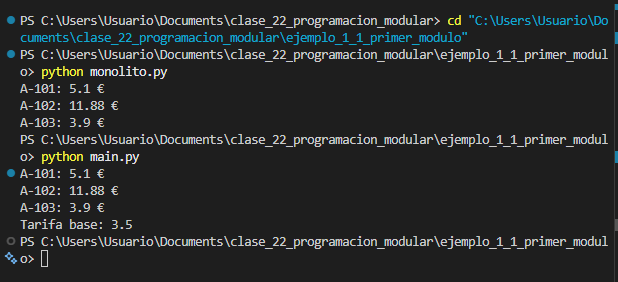

*Figura 2. Ejemplo 1.1: monolito.py y main.py.*

### Ejemplo 2.1 · Primer módulo con una función y una clase

```
ejemplo_2_1_modulo_saludos/
├── saludos.py
└── main.py
```

```powershell
python main.py
```

La forma 1 importa el módulo completo y accede con el prefijo saludos (saludos.saludar() y saludos.Saludo()). La forma 2 trae solo la clase con from saludos import Saludo y la usa sin prefijo.

Cada vez que se crea un objeto Saludo se ejecuta su __init__ y aparece el mensaje correspondiente.

### Ejemplo 2.2 · Un módulo de funciones financieras

```
ejemplo_2_2_modulo_finanzas/
├── finanzas.py
└── main.py
```

```powershell
python main.py
```

type(finanzas) devuelve <class 'module'>, lo que confirma que un módulo es un objeto. dir() filtrado muestra las cinco cosas que define el archivo: IVA_GENERAL, IVA_REDUCIDO, aplicar_descuento, con_iva y margen.

Los cálculos dan 121.0 con el IVA general, 110.0 con el reducido, 212.5 tras un 15 % de descuento sobre 250 y un margen del 40.0 %. map(finanzas.con_iva, precios) devuelve [145.2, 55.05, 96.8], con la función pasada sin paréntesis.

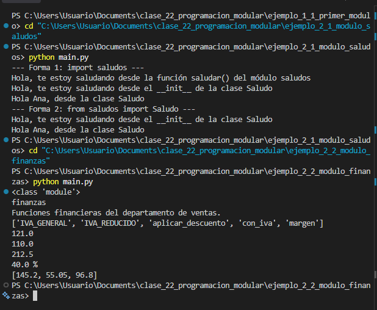

*Figura 3. Ejemplos 2.1 y 2.2.*

### Ejemplo 2.3 · Formas de importar y conflicto de nombres

```
ejemplo_2_3_formas_de_importar/
├── envios_nacionales.py
├── envios_internacionales.py
└── main.py
```

```powershell
python main.py
```

Las formas 1 a 4 conviven sin problema: el coste de 4 kg es 6.4 en el módulo nacional y 22.0 en el internacional. En la forma 5, el segundo from ... import calcular_coste sobrescribe sin aviso el nombre importado en la forma 3.

calcular_coste.__module__ confirma que ahora la función viene de envios_internacionales, por eso el resultado pasa de 6.4 a 22.0.

### Ejemplo 2.4 · Un módulo de utilidades con comprehensions y lambdas

```
ejemplo_2_4_modulo_comprehensions/
├── limpieza.py
└── main.py
```

```powershell
python main.py
```

Tras normalizar, los nombres quedan con formato título y los dominios distintos son empresa.es y gmail.com (un set, sin repetidos). Los cuatro registros se reducen a tres emails distintos porque los dos de Ana López coinciden y en el diccionario el último sustituye al primero.

El gasto de Madrid es 525.5, suma de 320.5, 145 y 60. ORDENES expone los criterios de ordenación 'nombre' y 'gasto', y list(ORDENES) permite consultarlos desde fuera.

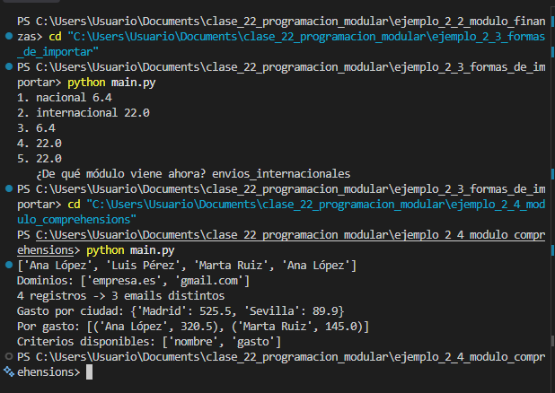

*Figura 4. Ejemplos 2.3 y 2.4.*

### Ejemplo 3.1 · Un módulo de configuración compartido

```
ejemplo_3_1_que_pasa_al_importar/
├── configuracion.py
├── informes.py
└── main.py
```

```powershell
python main.py
```

El mensaje [cargando el módulo configuracion] aparece una sola vez aunque el módulo se importa tres veces, porque a partir de la primera Python lo recupera de sys.modules. Las comprobaciones dan True: el módulo está en sys.modules e informes.configuracion es el mismo objeto que configuracion.

Al cambiar CONFIG desde main.py, informes.formatear() pasa de 1234.70 EUR a 1235 USD, lo que demuestra que ambos archivos comparten el objeto.

### Ejemplo 3.2 · Un objeto compartido por todos los módulos

```
ejemplo_3_2_objeto_compartido/
├── auditoria.py
├── pagos.py
├── envios.py
└── main.py
```

```powershell
python main.py
```

pagos.py y envios.py anotan en el mismo registro sin conocerse entre sí, y los tres eventos salen numerados del 1 al 3 en el orden en que ocurrieron. filtrar('pagos') devuelve 2.

La comparación encadenada registro is auditoria.registro is pagos.registro da True. La lista de envío sale como ['aceite', 'Cava', 'vino tinto'] porque la lambda ordena sin distinguir mayúsculas.

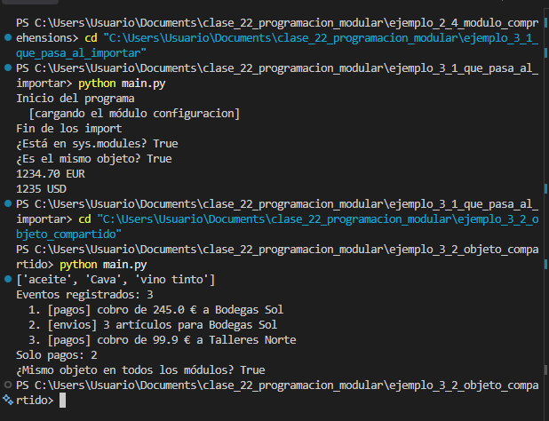

*Figura 5. Ejemplos 3.1 y 3.2.*

### Ejemplo 4.1 · Un módulo de validaciones con pruebas propias

```
ejemplo_4_1_name_main/
├── validaciones.py
└── main.py
```

```powershell
python validaciones.py
python main.py
```

Ejecutado directamente, validaciones.py muestra __name__ = '__main__' y lanza sus pruebas (True False y +34612345678 None). Importado desde main.py, __name__ vale 'validaciones' y el bloque de pruebas no se ejecuta.

En main.py, el archivo lanzado con python, __name__ es '__main__'. Bodegas Sol se descarta por su código postal 99001 y Talleres Norte conserva un teléfono None porque solo tiene seis cifras.

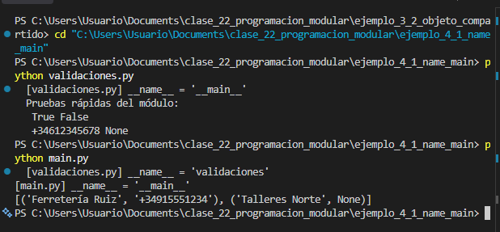

*Figura 6. Ejemplo 4.1: ejecución directa e importado.*

### Ejemplo 4.2 · Un módulo con una clase y sus propias pruebas

```
ejemplo_4_2_clase_con_pruebas/
├── conversor.py
└── main.py
```

```powershell
python conversor.py
python main.py
```

Las tres pruebas de conversor.py dan True con tasas inventadas (1.10 y 0.85) fáciles de verificar. Al importar la clase desde main.py las pruebas no se ejecutan y la salida queda limpia.

Con las tasas del día, 100 € equivalen a 108.0 USD, 86.0 GBP y 16250.0 JPY. Las facturas en USD son [1296.0, 377.89, 81.0] y solo F-01 y F-02 superan los 300 USD.

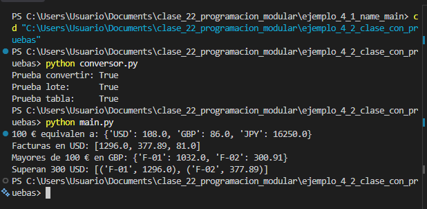

*Figura 7. Ejemplo 4.2: pruebas del módulo y programa principal.*

### Ejemplo 5.1 · Inventario de un almacén repartido en módulos

```
ejemplo_5_1_modulos_con_clases/
├── modelos.py
├── inventario.py
└── main.py
```

```powershell
python main.py
```

modelos.py define Producto y su derivada ProductoPerecedero, e inventario.py las usa para gestionar el almacén. El yogur se vende a 1.54 € porque le quedan 2 días y se aplica el 30 % de descuento sobre 2.20 €; el queso, con 40 días, mantiene su precio.

Bajo stock (<20) devuelve el yogur y el arroz, el valor total es 1108.8 y el orden por valor es SKU-01, SKU-04, SKU-02, SKU-03. Al agregar la cadena 'Leche' se lanza TypeError: Solo se admiten objetos Producto.

### Ejemplo 5.2 · Un módulo de reglas funcionales usado por una clase

```
ejemplo_5_2_clases_y_funciones/
├── politicas_precio.py
├── tarificador.py
└── main.py
```

```powershell
python main.py
```

Tarificador guarda una función como política y se limita a aplicarla al catálogo. Con Black Friday (35 %) las zapatillas pasan de 89.9 a 58.44, y con outlet quedan en 53.99: primero se aplica el 40 % (53.94) y luego el redondeo comercial a ,99.

La política creada al momento con crear_descuento(10) da 80.91 para las zapatillas. Las políticas disponibles son normal, rebajas, black_friday y outlet.

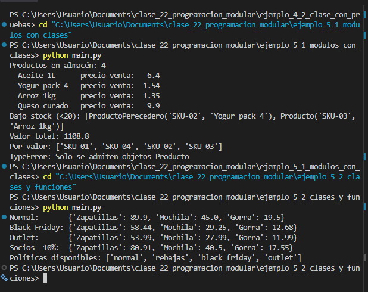

*Figura 8. Ejemplos 5.1 y 5.2.*

### Ejemplo 6.1 · Un archivo que tapa a un módulo estándar

```
ejemplo_6_1_donde_busca_python/
├── random.py
└── main.py
```

```powershell
python main.py
```

sys.path[0] es la carpeta del ejemplo, así que Python encuentra antes mi random.py que el módulo estándar. random.__file__ lo confirma y random.randint falla con AttributeError.

Con Python 3.14 el mensaje del error añade una sugerencia: renombrar el archivo porque tiene el mismo nombre que el módulo estándar y lo tapa. La última línea, ModuleNotFoundError: No module named 'tarifas_2027', es el error provocado a propósito con un módulo inexistente.

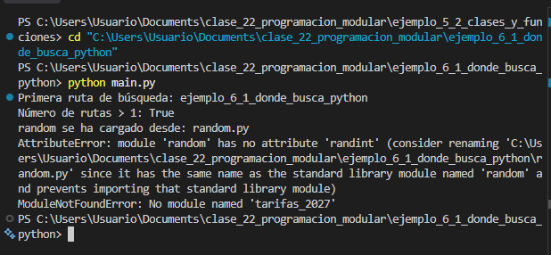

*Figura 9. Ejemplo 6.1: AttributeError y ModuleNotFoundError.*

## 3. Sesión 2: paquetes

### Ejemplo 7.1 · Un primer paquete de logística

```
ejemplo_7_1_primer_paquete/
├── logistica/
│   ├── __init__.py
│   ├── vehiculos.py
│   └── rutas.py
└── main.py
```

```powershell
python main.py
```

La distancia total de la ruta es 245.5 km y el coste sale a 85.92 € con la furgoneta y 220.95 € con el camión. Solo el camión puede cargar 3500 kg, porque la furgoneta admite 1200.

El paquete importado también es un objeto module. Los nombres completos aparecen como logistica, logistica.rutas y logistica.vehiculos.

### Ejemplo 7.2 · Subpaquetes

```
ejemplo_7_2_subpaquetes/
├── main.py
└── paquete/
    ├── __init__.py
    ├── hola/
    │   ├── __init__.py
    │   └── saludos.py
    └── adios/
        ├── __init__.py
        └── despedidas.py
```

```powershell
python main.py
```

main.py importa saludar de paquete.hola.saludos y la clase Despedida de paquete.adios.despedidas. La ruta del import sigue la ruta de carpetas.

main.py está junto a la carpeta paquete, por lo que Python la encuentra desde sys.path[0]. La salida muestra el mensaje de la función y el __init__ de Despedida.

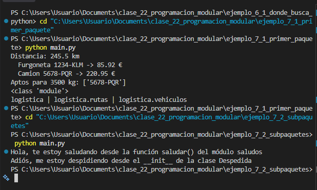

*Figura 10. Ejemplos 7.1 y 7.2.*

### Ejemplo 7.3 · El __init__.py como recepción e imports relativos

```
ejemplo_7_3_init_e_imports_relativos/
├── facturacion/
│   ├── __init__.py
│   ├── modelos.py
│   ├── calculos.py
│   └── factura.py
└── main.py
```

```powershell
python main.py
python facturacion\factura.py
```

Gracias al __init__.py, main.py importa Cliente y Factura directamente desde facturacion. La versión del paquete es 1.0.0, __all__ lista los tres nombres públicos y Factura.__module__ revela su ubicación real, facturacion.factura.

F-0001 suma 2400 €, aplica un 5 % de descuento por volumen (2280 €) y un 21 % de IVA, lo que da 2758.8 €. F-0002 no llega a 1000 € y solo lleva el 10 % de IVA: 704.0 €.

Ejecutar facturacion\factura.py directamente produce ImportError: attempted relative import with no known parent package, porque al lanzarlo como script Python no sabe que pertenece a un paquete.

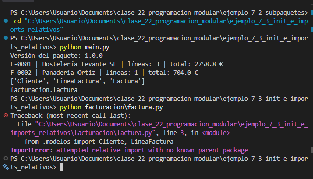

*Figura 11. Ejemplo 7.3: salida correcta y ImportError.*

### Ejemplo 8.1 · El cierre semanal de una cafetería con la biblioteca estándar

```
ejemplo_8_1_biblioteca_estandar/
└── main.py
```

```powershell
python main.py
```

Counter da café (3) y tostada (2) como más vendidos. statistics calcula un ticket medio de 1.86 y una mediana de 1.8, y math.ceil(7.3 / 2) obliga a pedir 4 sacos porque no se puede pedir medio saco.

Con datetime, siete días después del 2026-11-10 es el 2026-11-17. functools.partial fija el tipo de IVA del 10 % y la nueva función encaja en map(): [1.54, 2.31, 3.08].

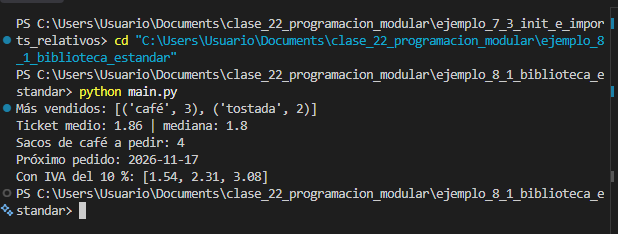

*Figura 12. Ejemplo 8.1.*

### Ejemplo 9.1 · Pipeline de ventas de una cadena de tiendas

```
ejemplo_9_1_pipeline_modular/
├── pipeline_ventas/
│   ├── __init__.py
│   ├── modelos.py
│   ├── extraccion.py
│   ├── transformacion.py
│   ├── carga.py
│   └── orquestador.py
└── main.py
```

```powershell
python main.py
```

De las 7 filas de entrada se cargan 5: la de Valencia con unidades 'dos' y la de Sevilla con unidades vacías no pasan es_valido(), y por eso Sevilla no aparece en los totales.

Los totales por tienda son Madrid 18.0, Barcelona 24.4 y Valencia 14.0, y los dos productos con más ventas son café molido (36.0) y cacao (14.0). main.py solo conoce ejecutar_pipeline.

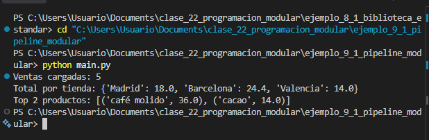

*Figura 13. Ejemplo 9.1.*

### Ejemplo 9.2 · Del notebook a producción

```
ejemplo_9_2_notebook_a_produccion/
├── informe_ventas.py
└── pedidos_etl/
    ├── main.py
    ├── probar_transformacion.py
    └── etl/
        ├── __init__.py
        ├── config.py
        ├── modelos.py
        ├── extraccion.py
        ├── transformacion.py
        ├── carga.py
        └── orquestador.py
```

```powershell
python informe_ventas.py
python main.py
```

El notebook original se reproduce en informe_ventas.py, con cada celda marcada en un comentario, para poder ejecutarlo sin Jupyter. Después se ejecuta la versión modular desde pedidos_etl.

Las dos salidas son idénticas: 7 pedidos leídos, P004 y P007 rechazados por datos erróneos, P002 cancelado, 4 procesados y ventas con IVA de Sevilla 96.80 €, Madrid 91.65 € y Valencia 27.10 €.

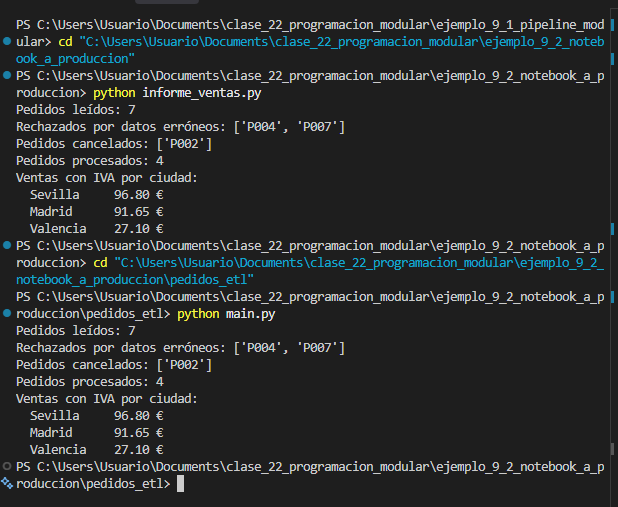

*Figura 14. Ejemplo 9.2: notebook convertido y versión modular.*

### Ejemplo 9.2 (prueba) · Probar una pieza por separado

```
pedidos_etl/
└── probar_transformacion.py
```

```powershell
python probar_transformacion.py
```

es_valido() se prueba sin ejecutar el pipeline. La línea con importe 19.95 es válida (True). La que escribe el importe con coma decimal (9,95) se parte en 6 campos y da False, y la que tiene el importe vacío también da False.

En el notebook, esa línea con coma habría pasado la validación tomando 9 como importe y 95 como estado, sin ningún error.

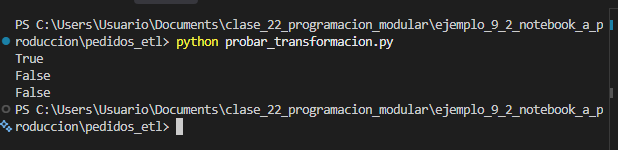

*Figura 15. Prueba de es_valido() por separado.*

## 4. Comprobación de resultados

Cada salida se ha contrastado con la salida esperada del enunciado.

| Ejemplo | Salida comprobada | Resultado |
| --- | --- | --- |
| 1.1 | A-101: 5.1 €, A-102: 11.88 €, A-103: 3.9 € | Coincide |
| 2.1 | Mensajes de saludos con las dos formas de importar | Coincide |
| 2.2 | 121.0, 110.0, 212.5, 40.0 %, [145.2, 55.05, 96.8] | Coincide |
| 2.3 | 6.4, 22.0, 6.4, 22.0, 22.0 y módulo envios_internacionales | Coincide |
| 2.4 | 4 registros, 3 emails; Madrid 525.5 | Coincide |
| 3.1 | Carga única; 1234.70 EUR y 1235 USD | Coincide |
| 3.2 | 3 eventos, 2 de pagos, mismo objeto True | Coincide |
| 4.1 | __main__ y 'validaciones'; pruebas solo en ejecución directa | Coincide |
| 4.2 | Tres pruebas True y salida de main.py | Coincide |
| 5.1 | Valor total 1108.8 y TypeError con 'Leche' | Coincide |
| 5.2 | Black Friday, outlet, socios -10 % | Coincide |
| 6.1 | AttributeError y ModuleNotFoundError | Coincide (el mensaje incluye sugerencia en 3.14) |
| 7.1 | 245.5 km; 85.92 € y 220.95 € | Coincide |
| 7.2 | Mensajes de saludar() y Despedida() | Coincide |
| 7.3 | 2758.8 €, 704.0 € e ImportError relativo | Coincide |
| 8.1 | Counter, estadística, 4 sacos, 2026-11-17 | Coincide |
| 9.1 | 5 ventas cargadas; totales y top 2 | Coincide |
| 9.2 | Notebook y versión modular con la misma salida | Coincide |
| 9.2 (prueba) | True, False, False | Coincide |

## Contenido de la entrega

```
clase_22_programacion_modular/
├── README.md
├── Clase22_Programacion_modular.pdf
├── img/                 capturas recortadas (originales completas en img/originales/)
└── codigo/              los 18 ejemplos y crear_clase22.py
```
